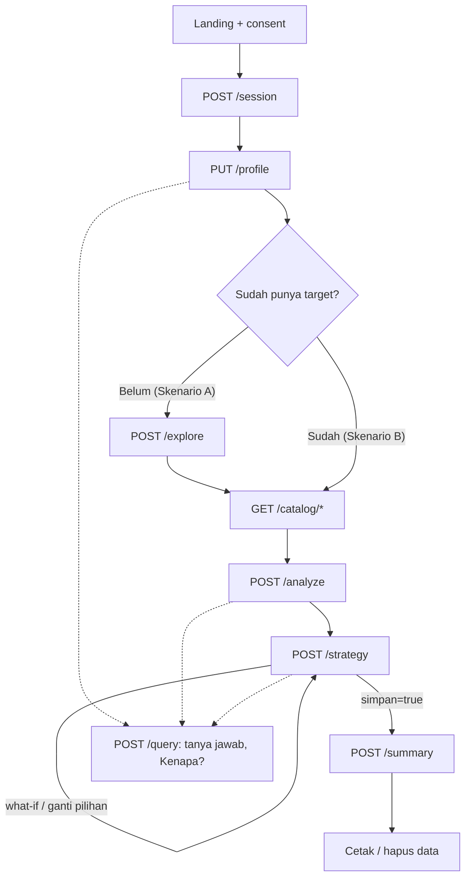
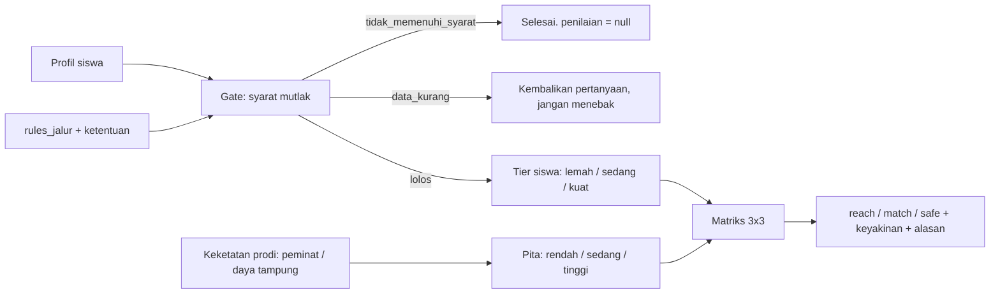
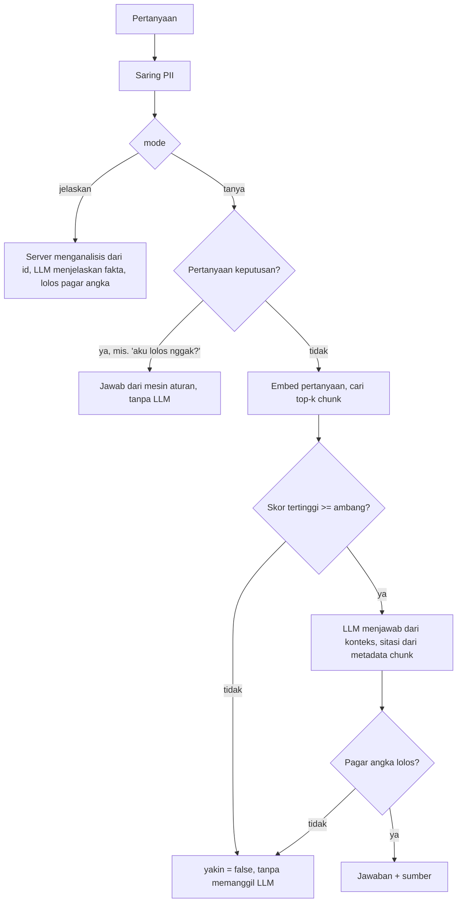
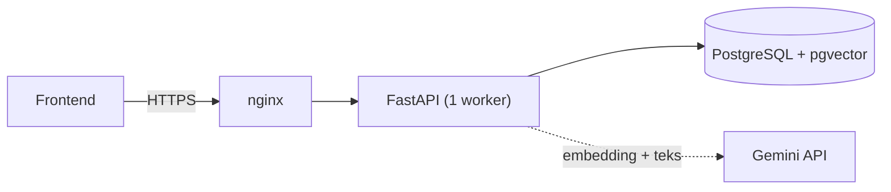

# JalurKu Backend

Backend untuk JalurKu, asisten siswa SMA/sederajat dalam menyusun strategi pilihan program studi lewat jalur SNBP dan SNBT. Dibuat untuk hackathon (siklus pendaftaran 2026). Spesifikasi lengkap ada di [`PRD-backend-jalurku.md`](PRD-backend-jalurku.md), catatan data di [`CATATAN.md`](CATATAN.md).

> **Status: prototipe.** Hanya untuk persona fiktif. Jangan dipakai untuk data siswa nyata sebelum konfirmasi hukum soal data anak (UU PDP) dan persetujuan orang tua/wali. Semua data resmi di repositori ini **belum diverifikasi manusia** (lihat [bagian data](#9-data-dan-verifikasi)).

---

## Daftar isi

1. [Prinsip desain](#1-prinsip-desain)
2. [Fitur dan endpoint](#2-fitur-dan-endpoint)
3. [Flow sistem](#3-flow-sistem)
4. [Arsitektur dan struktur folder](#4-arsitektur-dan-struktur-folder)
5. [Mulai cepat (lokal)](#5-mulai-cepat-lokal)
6. [Cara pakai API](#6-cara-pakai-api)
7. [Mesin aturan: gate, penilaian reach/match/safe, strategi](#7-mesin-aturan)
8. [Tanya-jawab (RAG) dan eksplorasi jurusan](#8-tanya-jawab-rag-dan-eksplorasi-jurusan)
9. [Data dan verifikasi](#9-data-dan-verifikasi)
10. [Konfigurasi](#10-konfigurasi)
11. [Deploy produksi](#11-deploy-produksi)
12. [Pengujian dan evaluasi](#12-pengujian-dan-evaluasi)
13. [Keamanan dan privasi](#13-keamanan-dan-privasi)
14. [Batasan yang diketahui](#14-batasan-yang-diketahui)
15. [Yang perlu dikerjakan selanjutnya](#15-yang-perlu-dikerjakan-selanjutnya)

---

## 1. Prinsip desain

1. **Keputusan dibuat mesin aturan, bukan LLM.** Lolos atau tidaknya syarat, serta kategori reach/match/safe, dihitung oleh kode deterministik. LLM hanya menjelaskan hasil dan menjawab pertanyaan dari dokumen resmi.
2. **Tidak ada persentase peluang.** Semua kategori berlabel *indikatif* (heuristik), disertai alasan dan tingkat keyakinan.
3. **Jujur saat tidak tahu.** Data kurang menghasilkan pertanyaan, bukan tebakan. Pertanyaan di luar dokumen dijawab `yakin: false`. Prodi tanpa data keketatan dinilai `belum_ada_acuan`.
4. **Setiap hasil membawa sumber.** Tiap hasil memuat `sumber`, `terakhir_diverifikasi`, dan `status_verifikasi`. Tanggal verifikasi hanya diisi manusia, tidak pernah otomatis.
5. **Tetap jalan tanpa LLM.** Bila Gemini mati atau kuota habis, semua keputusan tetap tampil dengan teks cadangan (HTTP 200, `fallback: true`).
6. **Privasi sejak awal.** Sesi tamu tanpa akun, tanpa data identitas, tombol hapus data, PII disaring sebelum ke LLM.

---

## 2. Fitur dan endpoint

Semua endpoint ada di bawah `/api/v1`. Selain `GET /health` dan `POST /session`, semuanya butuh header `Authorization: Bearer <token>`.

| Endpoint | Fungsi |
|---|---|
| `GET /health` | Cek koneksi database (tidak memanggil LLM) |
| `POST /session` | Buat sesi tamu (wajib consent), mengembalikan token |
| `GET /session` | Status sesi dan sisa waktu |
| `DELETE /session` | "Hapus data saya": hapus sesi dan semua data turunannya |
| `GET /profile`, `PUT /profile` | Baca dan simpan profil (parsial), kembalikan `data_kurang` dan pertanyaannya |
| `GET /catalog/ptn`, `/catalog/prodi`, `/catalog/prodi/{id}` | Telusuri PTN dan prodi (filter, paginasi, detail keketatan) |
| `GET /riasec/questions` | Butir tes minat RIASEC (publik, tanpa token). Template tetap, tanpa LLM |
| `POST /riasec/submit` | Skor minat dari jawaban (boleh parsial), Holland code, keyakinan; `simpan: true` memetakannya ke `profil.minat` |
| `POST /explore` | Rekomendasi rumpun jurusan dari minat dan nilai (tanpa LLM) |
| `POST /analyze` | Gate lalu penilaian per prodi per jalur, mendukung `override` (what-if) |
| `POST /strategy` | Evaluasi komposisi pilihan per jalur, saran swap, what-if, simpan strategi |
| `POST /summary` | Ringkasan strategi siap cetak dari strategi tersimpan |
| `POST /query` | Tanya-jawab bersitasi (RAG) atau penjelasan hasil ("Kenapa?") |
| `POST /admin/ingest` | Impor data (header `X-Admin-Key`) |
| `POST /admin/dokumen/{id}/berkas` | Unggah PDF sumber RAG (header `X-Admin-Key`) |

Dokumentasi interaktif (Swagger) ada di `/docs` saat `APP_ENV=dev`. Di produksi dimatikan.

Format error seragam:

```json
{"error": {"kode": "validasi_gagal", "pesan": "Data yang dikirim tidak valid", "detail": {}}}
```

---

## 3. Flow sistem

### 3.1 Alur pengguna

Ada dua skenario: **A** (belum punya target jurusan) dan **B** (sudah punya target).



### 3.2 Pipeline penilaian satu target



### 3.3 Alur `/query`



---

## 4. Arsitektur dan struktur folder



Stack: Python 3.11+, FastAPI, SQLAlchemy 2 (sinkron) + psycopg 3, Alembic, PostgreSQL 17 + pgvector, Gemini (`gemini-embedding-001` 768 dimensi dan model teks di `config/app.yaml`), uv, pytest, ruff.

```
app/
  api/v1/        endpoint (session, profile, catalog, explore, analyze, strategy, summary, query, admin)
  core/          config, error, keamanan token, rate limit
  db/            model SQLAlchemy, migrasi Alembic, guard startup (embedding, verifikasi)
  domain/        fungsi murni: gate, penilaian, strategi, ringkasan, match (tanpa DB/LLM/framework)
  services/      orkestrasi: profil, analisis, strategi, ringkasan, query, eksplorasi, persona
  ingest/        konversi CSV/JSON ke tabel, validasi per baris
  llm/           klien Gemini, cache, penyaring PII, pagar keluaran, prompt, teks cadangan
  rag/           ekstraksi PDF/HTML, chunking, ingest embedding, pencarian
  evaluasi/      pengukur golden set, render halaman statis persona
  schemas/       model Pydantic request/response
config/
  app.yaml       semua angka yang bisa dikalibrasi (bobot, batas, matriks, rate limit, ...)
  personas/      4 persona fiktif + hasil yang diharapkan
  golden/        33 kasus uji gate
data/
  seed/          CSV data resmi dan katalog (milik tim data)
  dokumen/       PDF sumber RAG (diunduh manual, tidak masuk repo)
  demo_statis/   halaman HTML ekspor persona fiktif
api-collection/  Postman Collection v2.1 + environment (dihasilkan scripts/build_api_collection.py)
deploy/          docker compose produksi, nginx, skrip deploy dan sertifikat
scripts/         CLI: ingest, ingest_docs, check_verified, run_golden_set, smoke_test, ...
tests/           pytest (978 tes), golden_gate/, golden_rag/
```

Aturan penting kode: `app/domain/` tidak boleh meng-import LLM, RAG, SQLAlchemy, atau FastAPI (dijaga tes). Hanya `app/llm/client.py` yang boleh meng-import SDK Google (dijaga tes).

---

## 5. Mulai cepat (lokal)

Prasyarat: Python 3.11+, [uv](https://docs.astral.sh/uv/), Docker (untuk PostgreSQL + pgvector).

```bash
# 1. Salin env lalu isi seperlunya (GEMINI_API_KEY boleh kosong)
cp .env.example .env

# 2. Jalankan database (port host 5433; membuat DB jalurku dan jalurku_test)
docker compose up -d db

# 3. Pasang dependensi, migrasi skema, muat data seed
uv sync
uv run alembic upgrade head
uv run python -m scripts.ingest

# 4. Jalankan server
uv run uvicorn app.main:build_app --factory --port 8000
```

Buka `http://localhost:8000/docs`.

> Di Windows bila uv dipasang lewat pip, ganti `uv` dengan `python -m uv`.

Tanpa `GEMINI_API_KEY`, semuanya berjalan kecuali tanya-jawab RAG dan narasi LLM (keduanya memakai teks cadangan).

Perintah berguna:

| Tujuan | Perintah |
|---|---|
| Semua tes | `uv run pytest` |
| Lint dan format | `uv run ruff check . --fix` lalu `uv run ruff format .` |
| Muat sebagian data | `uv run python -m scripts.ingest --tipe katalog acuan` |
| Coba gate dari terminal (tanpa DB) | `uv run python -m scripts.try_gate config/personas/budi.json SNBT` |
| Daftar model Gemini yang tersedia untuk kunci Anda | `uv run python -m scripts.list_models` |
| Cek kunci Gemini dan model | `uv run python -m scripts.check_gemini` |
| Bangun ulang API collection | `uv run python -m scripts.build_api_collection` |
| Buat sesi persona untuk uji manual | `uv run python -m scripts.seed_personas --persona rani --simpan-strategi` |

---

## 6. Cara pakai API

Contoh berikut memakai persona fiktif **Dimas** (sudah punya target). Cara tercepat mendapatkan token dan profil: `uv run python -m scripts.seed_personas --persona dimas` lalu salin token yang dicetak. Untuk mencoba manual, Swagger UI di `/docs` (tombol *Authorize*) lebih mudah daripada curl.

```bash
BASE=http://localhost:8000/api/v1

# 1. Buat sesi (consent wajib)
curl -s -X POST $BASE/session -H 'Content-Type: application/json' \
  -d '{"consent": true, "consent_version": "2026-10-13"}'
# -> {"token": "...", "expires_at": "...", "sisa_detik": 86400}
TOKEN=...   # isi dengan token di atas
AUTH="Authorization: Bearer $TOKEN"

# 2. Simpan profil (parsial; null menghapus nilai)
curl -s -X PUT $BASE/profile -H "$AUTH" -H 'Content-Type: application/json' \
  -d '{"tahun_lulus": 2026, "provinsi": "Jawa Barat", "jenjang_sekolah": "SMA",
       "akreditasi_sekolah": "B", "peringkat_sekolah": 30, "jumlah_siswa_angkatan": 120,
       "nilai_rapor": {"semester_1": {"matematika": 78, "fisika": 76}}}'
# -> {"profil": {...}, "data_kurang": {"SNBP": [...], "SNBT": [...]}, "pertanyaan": {"punya_nilai_tka": "..."}}

# 3. Analisis target (gate lalu penilaian)
curl -s -X POST $BASE/analyze -H "$AUTH" -H 'Content-Type: application/json' \
  -d '{"targets": [{"prodi_id": "ui-teknik-industri", "jalur": ["SNBP", "SNBT"]}]}'

# 4. Evaluasi strategi, what-if, lalu simpan
curl -s -X POST $BASE/strategy -H "$AUTH" -H 'Content-Type: application/json' \
  -d '{"jalur": "SNBT",
       "pilihan": [{"prodi_id": "ui-teknik-industri"}, {"prodi_id": "ui-teknik-elektro"},
                   {"prodi_id": "ui-v-akuntansi-d3"}],
       "shortlist": ["ui-v-fisioterapi"],
       "override": {"skor_tryout": 650},
       "simpan": false}'

# 5. Ringkasan dari strategi tersimpan
curl -s -X POST $BASE/summary -H "$AUTH" -H 'Content-Type: application/json' -d '{}'

# 6. Tanya-jawab dan penjelasan
curl -s -X POST $BASE/query -H "$AUTH" -H 'Content-Type: application/json' \
  -d '{"pertanyaan": "Kenapa hasilnya reach?", "mode": "jelaskan",
       "konteks": {"prodi_id": "ui-teknik-industri", "jalur": "SNBT"}}'

# 7. Hapus semua data sesi ini
curl -s -X DELETE $BASE/session -H "$AUTH"
```

Potongan respons `/analyze` (diringkas):

```json
{"hasil": [{
  "prodi_id": "ui-teknik-industri", "jalur": "SNBT",
  "prodi": {"nama": "Teknik Industri", "ptn_nama": "Universitas Indonesia", "jenjang": "S1", "program": "akademik"},
  "gate": {"status": "lolos", "syarat": [{"id": "SNBT-01", "status": "lolos", "alasan": null}]},
  "penilaian": {
    "kategori": "match", "keyakinan": "rendah", "indikatif": true,
    "tier": {"nilai": "sedang", "sumber": "proksi_rapor"},
    "pita": {"nilai": "rendah", "rasio": 27.65},
    "alasan": "Tier siswa ... menghasilkan kategori match. Ini heuristik indikatif, bukan peluang."
  },
  "sumber": ["https://files.snpmb.id/..."],
  "terakhir_diverifikasi": null, "status_verifikasi": "belum_diverifikasi",
  "data_kurang": [], "catatan": []
}]}
```

### API Collection (Postman, Insomnia, Bruno, Thunder Client)

Koleksi siap pakai ada di [`api-collection/`](api-collection/) dalam format Postman Collection v2.1, yang juga bisa diimpor Insomnia, Bruno, dan Thunder Client.

| Berkas | Isi |
|---|---|
| `JalurKu.postman_collection.json` | 60 request dengan deskripsi, contoh bodi dari persona, dan skrip uji otomatis |
| `JalurKu.lokal.postman_environment.json` | `baseUrl = http://localhost:8000` |
| `JalurKu.produksi.postman_environment.json` | `baseUrl = //Not Deployed Yet`|

Cara memakai:

1. Impor koleksi dan satu environment, lalu pilih environment itu di pojok kanan atas.
2. Isi `adminKey` (bertipe secret) hanya bila ingin mencoba folder **10 Admin**.
3. Jalankan folder **00 Alur lengkap** lewat Collection Runner. Folder ini membuat sesi sendiri dan menghapusnya di akhir. Atau klik **02 Sesi > Buat sesi (consent)** untuk request satuan.

Skrip uji pada *Buat sesi* menyimpan token ke variabel koleksi `token`, dan semua request lain memakainya lewat otorisasi Bearer koleksi. Skrip uji pada *Simpan strategi* menyimpan `strategy_id` ke `strategyId`. Variabel `prodiId`, `dokumenId`, dan `consentVersion` bisa diubah.

Isi folder: dua alur lengkap (**A** Rani belum punya target, **B** Dimas sudah punya target), lalu satu folder per modul (Kesehatan, Sesi, Profil, Katalog, Eksplorasi, Analisis, Strategi, Ringkasan, Tanya jawab, Admin), **Kasus gagal** (400, 401, 404, 422), dan **Akhiri sesi**. Setiap request punya uji status dan kunci respons, dan sebagian memeriksa temuan atau nilai `yakin`.

Koleksi **dihasilkan dari kode**, jangan diedit tangan. Bodi persona diambil dari `config/personas`, jadi tetap sinkron dengan data demo.

```bash
uv run python -m scripts.build_api_collection          # tulis ulang api-collection/
uv run python -m scripts.build_api_collection --cek    # gagal bila berkas di repo sudah usang
```

`tests/test_api_collection.py` menjaga agar koleksi tidak usang: setiap endpoint di OpenAPI wajib ada di koleksi (dan sebaliknya), semua variabel terdefinisi, dan seluruh alur koleksi diputar ulang terhadap API sungguhan dengan status dan kunci respons yang dideklarasikan. Menambah endpoint tanpa memperbarui koleksi akan membuat tes gagal.

Catatan: request unggah PDF (`10 Admin > Unggah PDF sumber RAG`) membutuhkan Anda memilih berkas sendiri, jadi tidak ikut diputar ulang oleh tes.

### Persona demo

Empat persona fiktif ada di `config/personas/*.json` (semuanya di Jawa Barat). File yang sama dipakai skrip seed, tes golden, ekspor statis, dan tombol "Muat persona demo" di frontend.

| Persona | Skenario | Yang didemokan |
|---|---|---|
| **Rani** | A, belum punya target | Eksplorasi, penilaian SNBT, strategi 2 Sarjana + 1 D3 |
| **Dimas** | B, sudah punya target | Dua jalur, peringkat tepat di batas kuota 25 persen, what-if |
| **Budi** | Kasus tepi | Lulusan 2023, SNBT gugur dengan alasan, penilaian `null` |
| **Sinta** | Data kurang | Profil sebagian, hasil `data_kurang` beserta pertanyaan |

---

## 7. Mesin aturan

### 7.1 Gate (syarat mutlak)

Gate dievaluasi dari tabel `rules_jalur` dan `ketentuan` (dimuat dari CSV), tanpa `eval`. Tiap syarat menghasilkan satu status:

| Status syarat | Arti |
|---|---|
| `lolos` | Terpenuhi |
| `gagal` | Tidak terpenuhi (disertai alasan dari data) |
| `data_kurang` | Data profil belum ada. Dikembalikan sebagai pertanyaan, tidak ditebak |
| `tidak_berlaku` | Tidak relevan (mis. syarat usia Paket C bagi siswa SMA) |

Status gate gabungan: `tidak_memenuhi_syarat` bila ada yang `gagal` (menang atas `data_kurang`), `data_kurang` bila tidak ada yang gagal tetapi ada data kurang, selain itu `lolos`. Penilaian hanya dijalankan bila gate `lolos`.

Syarat siklus 2026 yang termuat (13 syarat, dari paparan resmi SNPMB 2026):

- **SNBP (8)**: tahun lulus sama dengan tahun siklus, jenjang SMA/SMK/MA, sekolah punya NPSN, kurikulum nasional, peringkat dalam kuota sekolah (A 40%, B 25%, C dan lainnya 5%, tambah 5% bila sekolah memakai e-Rapor), punya nilai TKA, rapor lengkap di PDSS, dan syarat khusus prodi (dikonfirmasi siswa per prodi).
- **SNBT (5)**: lulus dalam tiga tahun terakhir (siklus dan dua tahun sebelumnya), usia Paket C maksimal 25 tahun per 1 Juli, WNI ber-NIK, belum lulus SNBP dalam tiga tahun terakhir, belum ikut UTBK pada siklus ini.

Batas bersifat inklusif dan dihitung eksak (peringkat 30 dari 120 = tepat 25% = lolos; peringkat 31 = gagal).

### 7.2 Penilaian reach / match / safe

Penilaian adalah **heuristik indikatif**, bukan probabilitas. Kategori didapat dari matriks 3x3 antara **tier siswa** dan **pita keketatan prodi**.

**Langkah 1, tier siswa (lemah / sedang / kuat).** Rata-rata tertimbang faktor yang diketahui, nilai 0 sampai 1:

| Faktor | Cara hitung | Bobot awal |
|---|---|---|
| `rapor` | rata-rata semua nilai rapor semester 1 sampai 5, dibagi 100 | 0,5 |
| `tren` | selisih rata-rata semester akhir dan awal, skala 20 poin = 0,0 sampai 1,0 | 0,2 |
| `peringkat` | (jumlah siswa − peringkat + 1) / jumlah siswa | 0,3 |

Faktor yang tidak diketahui dikeluarkan dan bobotnya dinormalisasi ulang, lalu ditandai di `faktor_tidak_diketahui`. `rapor` wajib. Batas tier: skor < 0,60 = **lemah**, 0,60 sampai < 0,80 = **sedang**, ≥ 0,80 = **kuat**. Akreditasi sekolah tidak ikut menghitung tier (hanya dipakai di gate dan konteks).

**Langkah 2, pita keketatan (rendah / sedang / tinggi).** Rasio = peminat tahun lalu / daya tampung. Batas pita:

- **SNBT**: dari **persentil 33 dan 67** sebaran rasio prodi di data, dihitung **per program** (akademik dan vokasi terpisah, `snbt.pita_keketatan.kelompok: program`). UI menyebut "relatif terhadap prodi yang ada di data". Perlu minimal 8 prodi pembanding per kelompok, kalau kurang hasilnya `belum_ada_acuan`.
- **SNBP**: batas tetap 5 dan 15 (dapat diganti ke persentil lewat config).

**Langkah 3, matriks.** Baris = tier, kolom = pita:

| Tier \ Pita | Rendah | Sedang | Tinggi |
|---|---|---|---|
| **Kuat** | safe | match | reach (catatan batas) |
| **Sedang** | match | reach (catatan batas) | reach |
| **Lemah** | reach (catatan batas) | reach | reach |

Sel bertanda "catatan batas" bernilai awal `reach` dan menampilkan catatan bahwa posisinya di batas match/reach. Isi sel bisa diubah di `config/app.yaml` tanpa mengubah kode.

**Label.** Setiap kategori dari matriks berlabel **"indikatif, belum dikalibrasi"** (`label_penilaian` di config), dan ringkasan menambahkan catatan yang sama. Nilai bobot, batas tier, dan matriks adalah bawaan awal, belum diuji terhadap data tahun lalu. Kategori dari `acuan_skor` berlabel "acuan siklus sebelumnya".

**Tingkat keyakinan.**

| Jalur | Keyakinan | Alasan |
|---|---|---|
| SNBT (tier dari rapor) | `rendah` | Tier hanya **proksi** dari rapor, bukan skor UTBK. Selalu ditandai "proksi dari rapor, bukan skor UTBK" |
| SNBT (tier dari skor tryout) | `sedang` | **Nonaktif** (`skala_skor_tryout: null`). Skor tryout tidak memengaruhi kategori. Aktif lagi bila skala diisi di config |
| SNBP, rekam jejak alumni diketahui | `sedang` | Alumni hanya memengaruhi keyakinan dan catatan, bukan sel matriks |
| SNBP, alumni kosong atau `tidak_tahu` | `rendah` | Kuota sekolah dan riwayat alumni memengaruhi hasil nyata |

**Hasil khusus:**

| `kategori` | Kapan |
|---|---|
| `belum_ada_acuan` | Prodi tidak punya data keketatan di jalur itu, atau sampel pembanding kurang. Tier tetap ditampilkan |
| `data_kurang` | Gate lolos tetapi nilai rapor belum ada, tier tak bisa dihitung |

**Jalur `acuan_skor`.** Bila tabel `acuan_skor` terisi untuk sebuah prodi (rentang skor `rendah` sampai `tinggi`), SNBT memakai perbandingan skor: `safe` bila skor ≥ batas atas, `match` bila di dalam rentang, `reach` bila di bawah (disertai `gap` poin). Tahun acuan lebih lama dari siklus diberi label "acuan siklus sebelumnya". Saat ini tabel kosong karena tidak ada passing grade resmi.

**Contoh nyata dari data seed saat ini** (Rani, Ilmu Komputer UI, SNBT):

1. Tier: kuat (skor 0,83, sumber proksi rapor).
2. Rasio keketatan: 2132 peminat / 75 daya tampung = 28,43.
3. Batas pita dari persentil 33 dan 67 atas 16 prodi akademik UI: [23,59 ; 31,08]. 28,43 berada di antaranya sehingga pita **sedang**.
4. `matriks[kuat][sedang]` = **match**, keyakinan **rendah**, label "indikatif, belum dikalibrasi".

> **Catatan perubahan.** Sebelumnya persentil dihitung dari semua prodi sekaligus. Itu membuat 15 prodi vokasi (rasio tinggi, 46 sampai 165) menggeser batas sehingga Ilmu Komputer UI tampil `safe`. Sejak 14 Oktober 2026 pita dihitung per program. Batas akademik [23,59 ; 31,08] (n = 16) dan vokasi [68,0 ; 97,38] (n = 15). Dampak pada persona: Rani, Ilmu Komputer dan Teknik Industri berubah `safe` menjadi `match`; Dimas, Teknik Industri berubah `match` menjadi `reach`.

### 7.3 Evaluasi strategi (`/strategy`)

Dievaluasi **per jalur**. Aturan batas dan komposisi berasal dari ketentuan resmi (`config_ketentuan.csv`), bukan dari config aplikasi.

| Tingkat | Kode temuan | Arti |
|---|---|---|
| Pelanggaran | `melebihi_batas_pilihan` | SNBP maksimal 2 pilihan, SNBT maksimal 4 |
| Pelanggaran | `provinsi_sekolah_asal` | SNBP dengan 2 prodi: salah satu harus di PTN provinsi sekolah asal |
| Pelanggaran | `provinsi_sekolah_belum_diisi` | Provinsi sekolah dibutuhkan untuk aturan di atas |
| Pelanggaran | `butuh_vokasi` | SNBT 3 sampai 4 pilihan tidak boleh seluruhnya Sarjana |
| Pelanggaran | `komposisi_snbt_tidak_valid` | Komposisi 3 atau 4 pilihan tidak sesuai ketentuan (mis. 3 Sarjana + 1 vokasi, atau tanpa minimal 1 D3) |
| Peringatan | `pilihan_tidak_memenuhi_syarat` | Ada pilihan yang gate-nya gagal |
| Peringatan | `min_safe` | Belum ada pilihan `safe` (minimal 1) |
| Peringatan | `maks_reach` | Porsi `reach` melebihi 50 persen dari pilihan yang dapat dinilai |
| Peringatan | `satu_ptn` | Semua pilihan di satu PTN |
| Info | `pilihan_data_kurang`, `pilihan_belum_ada_acuan`, `evaluasi_rasio_dilewati`, `blokir_lintas_jalur`, `hanya_satu_jalur` | Konteks tambahan |

Komposisi SNBT yang sah: 1 sampai 2 pilihan bebas; 3 pilihan = 2 Sarjana + 1 vokasi, atau 1 Sarjana + 2 vokasi, atau 3 vokasi dengan minimal 1 D3; 4 pilihan = 2 Sarjana + 2 vokasi, atau 1 Sarjana + 3 vokasi (keduanya minimal 1 D3).

**Saran swap** diambil hanya dari `shortlist` dan hanya diterima bila memperbaiki minimal satu masalah tanpa menimbulkan masalah baru. **What-if**: bila `override` ada, hasil dihitung ulang dan `simpan` dipaksa `false`, jadi profil dan strategi tersimpan tidak berubah.

### 7.4 Ringkasan (`/summary`)

Dihitung ulang dari strategi tersimpan terbaru per jalur dan profil saat ini (atau `strategy_id` tertentu). Berisi `pilihan_akhir`, `alasan`, `gap`, `fokus_persiapan` (diturunkan deterministik dari gap atau faktor terlemah), `dokumen_syarat` beserta sumber, `catatan`, dan `narasi`.

Narasi dibuat dari template. Bila `GEMINI_API_KEY` ada, LLM boleh menyusun narasi dari fakta mesin aturan, dan hanya dipakai bila lolos pagar keluaran (tanpa persentase, tanpa angka di luar fakta, kategori sesuai hasil mesin, teks polos). Selain itu template dipakai (`narasi_fallback: true`). Tidak ada tautan publik untuk berbagi ringkasan: hanya bisa diambil dengan token sesi.

---

## 8. Tanya-jawab (RAG) dan eksplorasi jurusan

### 8.1 `/query`

- **Mode `tanya`**: pertanyaan bebas. Pertanyaan keputusan pribadi ("aku lolos nggak?") dijawab mesin aturan, bukan LLM. Kalimat bersyarat ("kalau saya lulus SNBP, bolehkah ...") dianggap pertanyaan aturan dan masuk RAG. Selain itu: embed pertanyaan, ambil `top_k = 4` chunk dokumen resmi, bila skor tertinggi di bawah ambang `0,55` maka `yakin: false` tanpa memanggil LLM. Sitasi (judul, URL, halaman) selalu dari metadata chunk, bukan dari LLM.
- **Mode `jelaskan`** (tombol "Kenapa?"): wajib `konteks.prodi_id` dan `konteks.jalur`. Server menghitung ulang analisis dari id, LLM hanya menjelaskan fakta itu.
- Klien tidak boleh mengirim profil atau hasil analisis bebas ke `/query`; hanya identifier dan `override` terstruktur.
- Respons selalu berbentuk sama: `jawaban`, `sumber`, `yakin`, `data_dibutuhkan`, `saran_pertanyaan`, `fallback`, `mode`, `jenis_jawaban` (`rag`, `penjelasan`, `mesin_aturan`, `tidak_yakin`), `catatan`.
- Embedding dikunci ke `gemini-embedding-001` 768 dimensi. Aplikasi menolak start bila config tidak cocok dengan kolom `rag_chunks.embedding` atau model chunk yang sudah ada.

Memuat dokumen RAG: unduh PDF ke `data/dokumen/<dokumen_id>.pdf` (5 dokumen terdaftar di `dokumen_rag_metadata.csv`) atau unggah lewat `POST /admin/dokumen/{id}/berkas?proses=true`, lalu:

```bash
uv run python -m scripts.ingest_docs --dry-run   # cek chunking saja, tanpa API
uv run python -m scripts.ingest_docs             # embed dan simpan (butuh GEMINI_API_KEY)
uv run python -m scripts.search "Berapa jumlah pilihan prodi di SNBP?"   # uji pencarian
```

### 8.2 `/explore`

Deterministik dan tanpa LLM. Skor kecocokan tiap rumpun:

```
kecocokan = 0,5 x kemiripan_minat + 0,5 x kesesuaian_nilai
```

- `kemiripan_minat`: cosine antara vektor minat siswa dan vektor minat rumpun, atas enam dimensi RIASEC (`realistis`, `investigatif`, `artistik`, `sosial`, `enterprising`, `konvensional`).
- `kesesuaian_nilai`: rata-rata tertimbang nilai rapor semester 1 sampai 5 pada mapel relevan rumpun, dibagi 100. Mapel yang belum diisi dikeluarkan dan ditandai (`mapel_belum_diisi`).
- Komponen yang tidak bisa dihitung dikeluarkan dan bobot sisanya dinormalisasi. Bila minat dan nilai sama-sama kosong: `data_kurang`, tanpa rekomendasi.
- Tiap rekomendasi memuat `komponen`, `alasan` (template), `contoh_profesi`, `prodi_ids` dan daftar `ptn` pembukanya. Bila `jalur` diminta, ada juga `kelayakan` (ringkasan gate dan kategori dari mesin yang sama dengan `/analyze`).
- Urutan: skor yang tampil (2 desimal) menurun, lalu nama rumpun.

- `minat_sumber` menandai asal minat: `riasec` (dari tes, beserta `keyakinan` dan `alasan`), `manual` (diisi lewat `PUT /profile`, atau diubah setelah tes), atau `belum_diisi`. Tiap rekomendasi membawa `keyakinan_minat`; bila `rendah`, `catatan` memperingatkannya. Penanda ini **tidak mengubah skor atau urutan**.
- `penelusuran_katalog` berisi rumpun yang tidak bisa diberi skor (minat dan nilai belum diisi, atau rumpun tanpa profil), ditampilkan apa adanya tanpa skor.

> **Prioritas profil rumpun (minat, mapel relevan, contoh profesi):** data resmi (`prodi.tag_minat`, `prodi.mapel_penentu`, tabel `profesi`) lebih dulu, lalu **data draf** di `data/draft/` (ditandai `sumber_profil: draf`, `label_data: "draf, belum terverifikasi"`, `memakai_data_draf: true`), lalu klasifikasi awal di `config/app.yaml` (ditandai belum diverifikasi). Draf diturunkan mekanis dari klasifikasi rumpun, sama untuk semua prodi dalam satu rumpun, dan tidak dicampur ke CSV utama (lihat `data/draft/README.md`).

### 8.3 Tes minat RIASEC

Template tetap (bukan adaptif), skoring deterministik, tanpa LLM. **Bukan tes psikologi dan bukan diagnosis**: setiap hasil membawa pernyataan itu.

- **Instrumen**: `data/riasec/instrumen_v1.json` berisi 36 butir **orisinal tim** (6 per dimensi,
  berdasarkan definisi enam tipe Holland), skala 0..4 (`Sangat tidak suka` .. `Sangat suka`), versi
  `riasec-id-v1`. Butir **belum divalidasi psikometrik** dan bukan tes psikologi; lembar review untuk
  pemilik data dan guru BK ada di `reports/butir_riasec_review.csv` (berlabel "draf, belum
  diverifikasi"). `instrumen_contoh.json` hanya fixture tes; berkas yang tidak valid membuat aplikasi
  gagal start. Format lengkap di `data/riasec/README.md`; catatan kenapa butir PR #1 tidak dipakai di
  `docs/riasec-integrasi.md`.
- **Skor**: `skor_norm` dimensi = (rerata jawaban - skala.min) / (skala.maks - skala.min). Dimensi dengan butir 
terjawab di bawah `riasec.min_terjawab_per_dimensi` tidak dihitung (bukan dianggap 0); ambang itu juga dikirim 
sebagai `min_terjawab` pada `GET /riasec/questions` agar UI bisa memberitahu siswa. `holland_code` = huruf tiga 
dimensi teratas (seri diurutkan menurut urutan dimensi).
- **Cek kualitas** (angka di `riasec:` pada `config/app.yaml`): jawaban hampir seragam, profil datar, terlalu sedikit butir terjawab per dimensi. Bila terpicu, `keyakinan` menjadi `rendah` dengan `alasan_keyakinan`; hasil tidak ditolak.
- **Penyimpanan**: `simpan: true` memetakan skor ke `profil.minat` (dimensi yang tidak dihitung dihapus) dan menyimpan ringkasan kualitas di `riasec_hasil`. **Jawaban mentah tidak pernah disimpan**; data tes ikut terhapus bersama sesi.

---

## 9. Data dan verifikasi

Data resmi ada di `data/seed/*.csv` dan dimuat dengan `scripts.ingest` (atau `POST /admin/ingest`). Satu tipe = satu transaksi: satu baris salah berarti tidak ada yang tersimpan. Idempoten (upsert).

| Berkas | Tipe ingest | Isi |
|---|---|---|
| `config_ketentuan.csv` | `ketentuan` | Batas pilihan, kuota sekolah, komposisi SNBT, blokir lintas jalur |
| `rule_gate.csv`, `dokumen_wajib.csv` | `rules` | Syarat gate dan dokumen yang perlu disiapkan |
| `ptn.csv`, `prodi.csv` | `katalog` | 10 PTN, 185 prodi (hanya UI yang berdata keketatan SNBT), kolom `jenjang` dan `program` |
| `acuan_skor_snbt.csv` | `acuan` | Rentang skor acuan per prodi (kosong) |
| `dokumen_rag_metadata.csv` | `dokumen` | Metadata 5 dokumen resmi untuk RAG |
| `profesi.csv` (opsional) | `profesi` | Contoh profesi per rumpun untuk `/explore` |
| `golden_set.csv` | tidak di-ingest | 23 pertanyaan evaluasi RAG (`golden_set_draft.csv` adalah versi lama, tidak dipakai) |

**Verifikasi.** Kolom `terakhir_diverifikasi` hanya boleh diisi manusia setelah mencocokkan dengan sumber resmi, tidak pernah otomatis. Data yang kosong tetap bisa dipakai dan ditandai `belum_diverifikasi` di setiap respons API.

Status per 14 Oktober 2026: `config_ketentuan.csv`, `dokumen_wajib.csv`, `ptn.csv`, dan `rule_gate.csv` sudah bertanggal 2026-10-14. `prodi.csv` dan `dokumen_rag_metadata.csv` belum bertanggal. `acuan_skor_snbt.csv` sengaja kosong.

**Prodi tanpa data acuan.** Baris prodi yang tidak punya `daya_tampung` dan `peminat` (semua PTN selain UI, ditambah satu prodi UI) tidak dihitung terverifikasi, walaupun kolom tanggalnya terisi: tanggal itu diabaikan saat ingest (ringkasan ingest melaporkannya sebagai `prodi_tanpa_data_tanggal_diabaikan`). Penilaian prodi seperti ini menghasilkan `belum_ada_acuan` dengan status `belum_diverifikasi`, dan UI diminta menampilkan "belum ada data acuan".

Sebelum rekam video dan submit, nyalakan `REQUIRE_VERIFIED=true`. Efeknya:

1. Ingest menolak baris tanpa `terakhir_diverifikasi`.
2. API menolak start bila `rules_jalur`, `ketentuan`, atau `acuan_skor` masih memuat baris tanpa tanggal (tabel kosong dianggap lolos agar urutan deploy "naikkan stack, lalu ingest" tetap bisa).

Cek kesiapan kapan saja:

```bash
uv run python -m scripts.check_verified --detail
```

Skrip ini melaporkan tabel kritis, katalog, status persona, status kasus golden gate, dan kecukupan golden set RAG.

- **Wajib** (kode keluar 1 bila belum): tabel kritis `rules_jalur`, `ketentuan`, `acuan_skor`.
- **Peringatan** (tidak menggagalkan): katalog, persona, dan kasus gate. Gagal hanya dengan `--ketat`. Alasannya, hanya persona Rani yang diverifikasi pemilik data; persona lain dan `gate.json` sengaja tetap `hasil_terverifikasi: false`.
- Prodi tanpa daya tampung/peminat dilaporkan terpisah ("N prodi tanpa daya tampung/peminat"), tidak dihitung sebagai terverifikasi maupun gagal.

---

## 10. Konfigurasi

### Environment (`.env`, contoh di `.env.example`)

| Variabel | Fungsi |
|---|---|
| `DATABASE_URL` | Koneksi PostgreSQL (dev: port 5433) |
| `TEST_DATABASE_URL` | Database untuk pytest |
| `GEMINI_API_KEY` | Kunci Google AI Studio. Kosong = fitur LLM memakai teks cadangan |
| `LLM_MODEL` | Model generatif (menimpa `llm.model` di `app.yaml`). Cari nama valid dengan `scripts.list_models` |
| `LLM_MODEL_FALLBACK` | Model cadangan, dipisah koma. Dicoba berurutan saat model utama 404, 429, 503 (setelah satu ulangan), atau timeout, sebelum jatuh ke teks template |
| `EMBED_MODEL` | Model embedding (menimpa `embedding.model`). Dikunci bersama dimensi 768: mengganti berarti re-embed semua chunk |
| `ADMIN_KEY` | Kunci `X-Admin-Key`. Kosong = endpoint admin 404 |
| `CORS_ORIGINS` | Origin frontend, pisahkan koma |
| `SESSION_TTL_HOURS` | Masa berlaku sesi (menimpa `app.yaml`), bawaan 24 |
| `TRUSTED_PROXIES` | IP/CIDR reverse proxy yang dipercaya untuk `X-Forwarded-For` |
| `REQUIRE_VERIFIED` | `true` = tolak data tanpa tanggal verifikasi (ingest dan start) |
| `APP_ENV` | `dev` atau `prod`. `prod` mematikan `/docs` dan `/openapi.json` |

### `config/app.yaml`

Semua angka yang bisa dikalibrasi ada di sini dan **divalidasi saat start** (kunci salah ketik atau nilai tidak valid membuat aplikasi gagal start). Ringkasan seksi:

| Seksi | Isi |
|---|---|
| `sesi`, `rate_limit` | TTL, batas per sesi/IP/pembuatan sesi/LLM (awal: 120, 240, 20, 10 per menit) |
| `llm`, `embedding`, `rag` | Model, timeout, konkurensi, cache, ukuran chunk, `top_k`, `ambang_skor` |
| `minat`, `profil` | Dimensi minat, batas validasi profil |
| `snbp`, `snbt` | Bobot dan batas tier, metode pita, matriks, `skala_skor_tryout` |
| `strategi` | `min_safe`, `maks_rasio_reach`, peringatan |
| `query` | Pola deteksi pertanyaan keputusan |
| `explore` | Bobot, batas, dan klasifikasi awal tiap rumpun |

Semua bobot, batas, dan isi matriks memakai **nilai bawaan yang belum dikalibrasi** (hasil berlabel "indikatif, belum dikalibrasi"). Mengubahnya tidak memerlukan perubahan kode. Teks `teks.pemberitahuan_demo` ("demo memakai data fiktif") juga diatur di sini dan dikirim sebagai field `pemberitahuan` pada `POST /session` dan `GET /session`.

---

## 11. Deploy produksi

Satu server dengan Docker Compose: `nginx` (satu-satunya yang membuka port 80/443) → `api` → `db`, ditambah `certbot` untuk pembaruan sertifikat otomatis. File ada di `deploy/`.

```bash
cp deploy/.env.prod.example deploy/.env.prod     # isi DOMAIN, POSTGRES_PASSWORD, ADMIN_KEY, GEMINI_API_KEY, ...
bash deploy/deploy.sh --seed                     # build, naik, tunggu sehat, muat seed, smoke test internal
bash deploy/init-cert.sh                         # sekali saja: sertifikat Let's Encrypt lalu nginx pindah ke HTTPS
python -m scripts.smoke_test --base-url https://DOMAIN --prod --lewat-proxy   # uji dari luar server
```

Catatan penting:

- nginx memilih mode otomatis: **HTTP** bila sertifikat belum ada (hanya untuk bootstrap atau uji lokal, token terlihat di jaringan), **HTTPS** bila ada. Gunakan `STAGING=1 bash deploy/init-cert.sh` untuk uji alur tanpa menghabiskan batas Let's Encrypt.
- nginx menimpa `X-Forwarded-For` dengan IP sebenarnya, dan aplikasi hanya mempercayai header itu dari alamat nginx (`TRUSTED_PROXIES`), sehingga rate limit per IP tidak bisa dipalsukan.
- API dijalankan **satu worker** karena rate limiter dan semaphore LLM disimpan di memori proses.
- `/docs`, `/redoc`, dan `/openapi.json` tidak diproksi. Badan permintaan dibatasi 128 KB, kecuali `/api/v1/admin/` (hingga 40 MB untuk PDF).
- Halaman statis persona fiktif dibuat dengan `uv run python -m scripts.export_persona_static`, lalu salin `data/demo_statis/` ke server. nginx menyajikannya di `/demo-statis/`, terpisah dari DB dan sesi.
- Compose produksi memakai nama proyek `jalurku-prod`, berbeda dari compose dev (nama folder), agar kontainer dan volume keduanya tidak bertabrakan.
- Skrip `.sh` dijalankan di Linux/macOS. Di Windows pakai Git Bash.

Saat `deploy.sh` jalan dengan `REQUIRE_VERIFIED=true` dan data belum bertanggal, API sengaja menolak start. Log kontainer menunjukkan penyebab dan tabel mana yang bermasalah.

---

## 12. Pengujian dan evaluasi

```bash
docker compose up -d db
uv run pytest            # 978 tes. Jalankan satu pytest saja pada satu waktu (database uji dipakai bersama). Tes bertanda `db` dilewati bila PostgreSQL tidak tersedia
```

Terakhir hijau 978/978 pada 15 Okt 2026 (tag `v1.2-submit`, sebelum edit pemilik data). Saat ini
23 gagal + 2 error pengumpulan, semuanya `PersonaError` dari format tanggal verifikasi di
`config/personas/rani.json` (lihat bagian 15 A); kode tidak berubah sejak terakhir hijau.

Tidak ada tes yang memanggil Gemini asli: LLM diganti `FakeLLM` (`tests/fakes.py`).

**Golden set** (PRD bagian 14):

```bash
uv run python -m scripts.run_golden_set               # gate (33 kasus) + persona; target 100 persen
uv run python -m scripts.run_golden_set --rag         # + RAG; butuh GEMINI_API_KEY dan dokumen ter-ingest
```

- **Gate**: `config/golden/gate.json`, 33 kasus yang mencakup ke-13 syarat, kasus tepi tahun lulus, batas kuota sekolah, Paket C, dan kombinasi gagal + `data_kurang`. Harapan ditulis dari pembacaan syarat resmi, bukan disalin dari keluaran mesin. Saat ini 33 dari 33 sesuai.
- **RAG**: `data/seed/golden_set.csv` (23 pertanyaan: 13 dalam cakupan, 6 di luar cakupan, 4 keputusan). Lembar verifikasi halaman untuk 13 pertanyaan dalam cakupan ada di `reports/lembar_verifikasi.csv` (dokumen, halaman, kutipan pendek, status `ditemukan`/`perkiraan`/`tidak ditemukan`); kolom `halaman` di `golden_set.csv` sendiri **tidak** diisi otomatis dari lembar itu dan menunggu pemeriksaan manusia. Skor otomatis hanyalah proksi: pertanyaan di luar cakupan lulus bila `yakin: false`; pertanyaan keputusan lulus bila dijawab `mesin_aturan`; pertanyaan dalam cakupan diperiksa dari kecocokan sumber, halaman, dan angka kunci. Akurasi jawaban sebenarnya dinilai manusia lewat kolom `nilai_manual` pada laporan CSV (`reports/golden_rag_*.csv`). Run terakhir (15 Okt 2026, cache LLM dikosongkan): dalam cakupan **11 dari 13**, di luar cakupan 6 dari 6, keputusan 4 dari 4, fallback 0.
- **Smoke test pasca-deploy**: `scripts/smoke_test.py` menjalankan alur persona via HTTP, termasuk uji penolakan admin, `/docs` mati di produksi, dan header keamanan nginx.

---

## 13. Keamanan dan privasi

- **Sesi tamu**: token acak, hanya hash-nya yang disimpan, TTL 24 jam, pembersihan berkala. Tanpa akun.
- **Consent**: `POST /session` menolak tanpa `consent: true`. Backend mencatat `consent_at` dan `consent_version`.
- **Tanpa identitas**: skema profil sengaja tidak memuat nama, kontak, NIK, atau NISN. `wni_punya_nik` hanya boolean.
- **PII ke LLM**: pertanyaan disaring sebelum dicatat, di-cache, atau dikirim. Log pertanyaan juga tersaring.
- **Hapus data**: `DELETE /session` menghapus sesi dan semua data turunannya (cascade).
- **Rate limit**: per sesi, per IP, pembuatan sesi, dan khusus endpoint LLM. Endpoint admin juga dibatasi.
- **Admin**: `X-Admin-Key` dibandingkan dengan perbandingan waktu-konstan. Tanpa `ADMIN_KEY`, endpoint admin tampak tidak ada (404).
- **Pagar keluaran LLM**: tidak boleh memuat persentase atau peluang, angka di luar fakta, atau kategori yang berbeda dari hasil mesin.
- **Prompt injection**: teks pengguna dan dokumen dibungkus tag dan diperlakukan sebagai data.
- **Tidak ada tautan publik** untuk ringkasan. Halaman statis hanya untuk persona fiktif.

Konfirmasi hukum soal data anak (UU PDP) dan persetujuan orang tua/wali harus dilakukan **sebelum** peluncuran nyata. Tim bukan penasihat hukum.

---

## 14. Batasan yang diketahui

- **Katalog**: hanya UI yang punya data keketatan (daya tampung dan peminat) SNBT. Sembilan PTN lain berstatus `belum_ada_acuan`. Demo hanya memakai UI.
- **SNBP**: belum ada data keketatan sama sekali, jadi semua penilaian SNBP `belum_ada_acuan` (tier siswa tetap tampil).
- **SNBT**: tidak ada passing grade resmi. Kategori memakai keketatan relatif dan tier dari rapor sebagai proksi, makanya keyakinan `rendah`. Skor tryout tidak memengaruhi kategori (skala dinonaktifkan).
- **Belum dikalibrasi**: semua kategori berlabel "indikatif, belum dikalibrasi".
- **Pita keketatan** dihitung per program (akademik dan vokasi terpisah). Kelompok vokasi hanya 15 prodi.
- **Verifikasi**: `prodi.csv` dan `dokumen_rag_metadata.csv` belum bertanggal. Hanya persona Rani yang akan diverifikasi pemilik data; Dimas, Budi, Sinta, dan 33 kasus `gate.json` tetap `hasil_terverifikasi: false`, sehingga hasil golden berfungsi sebagai kunci regresi, bukan bukti kebenaran.
- **Data diri anak**: demo memakai data fiktif dan UI wajib menampilkan catatan itu. Konfirmasi hukum belum dikerjakan dan menjadi syarat sebelum peluncuran nyata.
- **Eksplorasi** memakai klasifikasi rumpun awal di `config/app.yaml` (bagian `explore`), bukan data resmi.
- **Rapor SMA semester 1 sampai 5** adalah tafsiran, bukan kutipan resmi. Pemeringkatan resmi SNBP memakai rerata semua semester kecuali semester terakhir.
- **Provinsi UI** di `ptn.csv` diubah sementara ke Jawa Barat (sumber lain menulis Jakarta) agar persona fiktif konsisten.
- **Nama model generatif**: bawaan `gemini-2.5-flash` di `app.yaml` sudah tidak tersedia (404). Isi `LLM_MODEL` di `.env` dengan nama dari `scripts.list_models`. Fallback model (`LLM_MODEL_FALLBACK`) hanya untuk generate; embedding tidak punya cadangan karena dikunci ke dimensi kolom. Hasil generate dari model cadangan disimpan di cache dengan kunci model utama.
- **Rate limiter dan semaphore LLM di memori**: hanya cocok untuk satu proses.
- **Siklus 2027** belum diumumkan resmi per 13 Oktober 2026. Semua data memakai siklus 2026 dengan label acuan siklus sebelumnya.
- `init-cert.sh` (Let's Encrypt nyata) dan `deploy.sh` di server Linux sungguhan belum diuji. Yang sudah diuji: build dan alur nginx HTTP/HTTPS (sertifikat self-signed) di Docker lokal.

---

## 15. Yang perlu dikerjakan selanjutnya

### A. Tim data (tidak butuh kode)

Status per 15 Oktober 2026. Item bercentang sudah selesai.

**Sudah selesai**

- [x] **Tanggal verifikasi** di `rule_gate.csv`, `config_ketentuan.csv`, `dokumen_wajib.csv`, dan `ptn.csv` (2026-10-14), sudah di-ingest dan `scripts.check_verified` lulus untuk tabel kritis.
- [x] **Kelompok pita SNBT** diubah ke `program`; `harapan.penilaian` Rani dan Dimas diperbarui (perubahan di 7.2).
- [x] **Kalibrasi**: diputuskan memakai nilai bawaan dengan label "indikatif, belum dikalibrasi", dicatat sebagai keterbatasan di PRD v1.1. `skala_skor_tryout` dinonaktifkan.
- [x] **Data keketatan**: SNBP, sembilan PTN lain, dan `acuan_skor_snbt.csv` sengaja dikosongkan. Hasilnya `belum_ada_acuan`, demo hanya UI.
- [x] **Golden set RAG** 23 baris (`golden_set.csv`), skrip pengisi halaman dari PDF sudah ada dan sudah dijalankan.
- [x] **Catatan "demo memakai data fiktif"** dikirim backend lewat field `pemberitahuan`.
- [x] **Catat perubahan PRD v1.1** (log perubahan, kontrak, keterbatasan) di PRD bagian 18.
- [x] **Unduh PDF** dokumen resmi: 4 dari 5 sudah ada di `data/dokumen/`.
- [x] **Tanggal verifikasi `prodi.csv` dan `dokumen_rag_metadata.csv`** (15 Okt 2026): `prodi.csv` 31 baris (semuanya UI yang berdata keketatan) bertanggal 2026-10-15, 154 baris lain sengaja kosong karena tanpa data acuan; `dokumen_rag_metadata.csv` 4 dari 5 bertanggal 2026-10-15, `snpmb-faq` sengaja kosong karena PDF-nya tidak pernah diunduh dan tidak ada di basis RAG. `scripts.check_verified`: tabel kritis OK (`rules_jalur` 2/2, `ketentuan` 22/22, `acuan_skor` 0/0), katalog OK (154 prodi tanpa data hanya INFO). Catatan: `dokumen_sumber` terbaca 5/5 karena skrip membaca DB yang di-ingest sebelum CSV diubah; ingest ulang akan menyelaraskan ke 4/5. Catatan 2: skrip saat ini berhenti di bagian persona karena format tanggal di `rani.json` (lihat item Rani di bawah).
- [x] **Verifikasi persona Rani** oleh pemilik data: `hasil_terverifikasi: true`, `diverifikasi_oleh: Rakhis-Yudha`, tanggal tertulis "10-Oktober-2026" di `config/personas/rani.json`. Lembar verifikasi `reports/verifikasi_rani.md` (35 cocok, 0 tidak cocok) menjadi dasar penandatanganan. **Perhatian**: tanggal tertulis bukan format YYYY-MM-DD sehingga validasi persona gagal — `scripts.check_verified` berhenti di bagian persona dan suite tes saat ini 23 gagal + 2 error pengumpulan (semuanya `PersonaError` dari string tanggal ini). Pemilik data perlu menulis ulang tanggalnya format YYYY-MM-DD. Persona Dimas, Budi, Sinta dan `config/golden/gate.json` (0/33) tetap `false` (keputusan pemilik data).

**Masih terbuka**
- [ ] **Cek halaman golden RAG**: 13 pertanyaan dalam cakupan sudah disiapkan lembar kerjanya di `reports/lembar_verifikasi.csv` (dokumen, halaman, kutipan pendek, status). Hasil pencarian otomatis: 6 `ditemukan`, 7 `perkiraan`, 0 `tidak ditemukan`. Periksa kutipan tiap baris, lalu isi kolom `halaman` di `data/seed/golden_set.csv` secara manual (jangan otomatis).
- [ ] **PDF `snpmb-faq`** (halaman web) belum ada di `data/dokumen/`.
- [ ] **Cek provinsi UI** di daftar resmi SNPMB. Provinsi tetap Jawa Barat sampai pemilik data memberi kabar. Bila berubah (mis. DKI Jakarta), ganti `provinsi` pada keempat persona.
- [ ] **Data eksplorasi resmi**: `tag_minat` dan `mapel_penentu` per prodi, serta `profesi.csv`. Saat ini `/explore` memakai **draf** di `data/draft/` (dibuat `scripts.buat_draf_eksplorasi`, berlabel "draf, belum terverifikasi", tanpa tanggal verifikasi). Verifikasi dan pindahkan ke CSV utama; data resmi otomatis didahulukan.
- [ ] **Review butir RIASEC** oleh pemilik data dan guru BK: `data/riasec/instrumen_v1.json` sudah
  berisi 36 butir orisinal tim (draf), lembar kerjanya di `reports/butir_riasec_review.csv`. Validasi
  psikometrik belum dilakukan. Setelah butir diubah, jalankan `scripts.build_api_collection`.
- [ ] **Konfirmasi hukum** soal data anak (UU PDP) dan persetujuan orang tua/wali. Belum dikerjakan; **syarat sebelum peluncuran nyata**.

### B. Backend dan AI

Status dicek 15 Oktober 2026 dengan panggilan Gemini nyata.

- [x] **`GEMINI_API_KEY`, model, dan kuota**: kunci dikonfirmasi pemilik. `scripts.check_gemini` lulus untuk embedding (`gemini-embedding-001`, 768 dimensi), model utama, dan model cadangan.
- [x] **Model generatif dan rantai cadangan** (15 Okt 2026): `LLM_MODEL=gemini-flash-lite-latest`, `LLM_MODEL_FALLBACK=gemini-3.1-flash-lite`, `timeout_detik: 10`. Rantai: model utama, ulangi sekali bila 503, model cadangan, lalu teks template. Fallback menangani 404, 429, 503, dan timeout; error lain (kredensial, 400) langsung ke template. Respons API tidak pernah 5xx karena LLM gagal. Alasan: `gemini-3.1-flash-lite` terukur tidak stabil (1,5 sampai 17 detik, 503, 504), sedangkan `gemini-flash-lite-latest` 8 dari 8 berhasil dalam 1 sampai 2,5 detik. Nama `-latest` adalah alias yang bisa berpindah versi.
- [x] **Ingest dokumen RAG sungguhan**: 4 dari 5 dokumen masuk (103 chunk). `snpmb-faq` sekarang opsional: bila berkasnya belum ada, ingest melewatinya (`[LEWATI]`) tanpa error.
- [x] **Ambang skor RAG: keputusan diambil — tidak disetel** (tetap 0,55 di `config/app.yaml`). Skor pertanyaan dalam cakupan (0,75 sampai 0,81) tumpang tindih dengan di luar cakupan (0,65 sampai 0,76), jadi ambang bukan pemisah dan 0,55 hampir tidak pernah menolak. Pemisahan bergantung pada instruksi LLM dan sitasi (PRD bagian 18). Keputusan ini dicatat sebagai keterbatasan.
- [x] **Golden RAG angka akhir** (`scripts.run_golden_set --rag`, 15 Okt 2026, 23 pertanyaan, cache dikosongkan, file `reports/golden_rag_20261015-095036.csv`): dalam cakupan **11 dari 13** lulus proksi otomatis (84,6 persen), di luar cakupan 6 dari 6, keputusan mesin aturan 4 dari 4, fallback 0. Sebelum perubahan prompt: 9 dari 13, 5 dari 6, 4 dari 4. Ini skor proksi, **bukan akurasi**. Dua yang gagal proksi dinilai **benar** oleh manusia di kedua berkas: baris 5 (halaman kutipan beda dari rujukan) dan baris 14 (jawaban 30% PTNBH benar; proksi gagal karena rujukan golden memuat tambahan 40% BLU yang tidak ditanyakan). Hasil bervariasi antar-run karena LLM tidak deterministik. Run ulang hari yang sama (`reports/golden_rag_20261015-120118.csv`) mendapat skor proksi yang sama (11/13, 6/6, 4/4, 0 fallback); 14 dari 23 jawaban berubah redaksionalnya, status lulus **proksi** tiap baris tidak berubah — tetapi penilaian manual berubah pada baris 3 dan 8 (benar→sebagian, lihat item `nilai_manual`).
- [x] **Isi `nilai_manual`** di kedua berkas golden (`095036` dan `120118`): 095036 → 13+6+4 **benar**; 120118 → dalam cakupan 11 benar + 2 sebagian (baris 3 dan 8), luar cakupan 6 benar, keputusan 4 benar. Penilai adalah pemilik data dengan draf bantuan (bukan independen); 23 pertanyaan (sampel kecil). Temuan manual run 120118: baris 3 turun benar→sebagian (kalimat batas umur 25 tahun terbaca berlaku untuk semua lulusan, padahal rujukan hanya Paket C — cek teksnya di panduan, bisa naik ke benar); baris 8 turun benar→sebagian (kasus 3 pilihan hilang pada run ini; run sebelumnya lengkap). Laporkan metrik apa adanya di pitch. Skor proksi bukan akurasi.
- [x] **Uji ketersediaan terhadap API nyata**: `/query` (7 jawaban jatuh ke template saat timeout dan 503 nyata, tanpa 5xx), dan narasi `/summary` (utama normal: narasi LLM; utama 404 lalu cadangan: narasi LLM; semua model gagal: narasi template, HTTP 200). Respons 429 nyata belum teramati sebagai respons API.
- [ ] **Uji kualitas kategori** secara mundur (backtest) dengan data tahun lalu bila tersedia. Sampai saat itu kategori hanya boleh dikomunikasikan sebagai heuristik.

### C. Deploy dan integrasi FE

Semua belum selesai. Urutan kerja yang disarankan di hari deploy:

- [ ] **VPS dan domain/subdomain** disiapkan; DNS menunjuk ke server; port 80/443 terbuka.
- [ ] **`.env` server** (jangan pakai berkas dev): `REQUIRE_VERIFIED=true`, `ADMIN_KEY` baru (bukan kunci smoke `kunci-smoke-uji-123`), `CORS_ORIGINS` ke origin frontend, kunci Gemini (`GEMINI_API_KEY`) dan nama model (`LLM_MODEL`, `LLM_MODEL_FALLBACK`, `EMBED_MODEL`) yang valid.
- [ ] **`compose up`, migrasi, dan ingest di server**: `alembic upgrade head`, `scripts.ingest`, `scripts.ingest_docs`; pastikan 103 chunk masuk (`SELECT count(*) FROM rag_chunks`).
- [ ] **`scripts.check_gemini` di hari deploy** (nama model bisa dihentikan penyedia; `-latest` bisa berpindah versi).
- [ ] **`siapkan_demo --hangatkan` di server** untuk sesi demo 72 jam dan cache LLM hangat sebelum rekaman.
- [ ] **Smoke test terhadap URL publik** (`scripts.smoke_container`/`smoke_test`): semua endpoint 200/201/204 sesuai harapan, `/docs` mati di produksi, admin 401 tanpa kunci dan 404 bila `ADMIN_KEY` kosong.
- [ ] **Konfirmasi dengan tim FE** soal field respons RIASEC yang dibaca dashboard: `holland_code`, `dimensi_teratas`, `skor_norm`, `keyakinan`, `alasan_keyakinan`, `min_terjawab`, `pernyataan`, `instrumen_contoh` (kontrak di `app/schemas/riasec.py`; tambahan satu-satunya adalah `min_terjawab`).
- [ ] **Deploy ke VPS**, jalankan `init-cert.sh` (coba `STAGING=1` dulu), lalu `smoke_test` dari luar server.
- [ ] **Ekspor halaman statis persona** (`scripts.export_persona_static`) dan salin `data/demo_statis/` ke server.
- [ ] Atur firewall (hanya 80/443), pencadangan volume `dbdata`, dan pemantauan log.
- [ ] Bila trafik tumbuh melebihi satu proses: pindahkan rate limiter dan batas konkurensi LLM ke penyimpanan bersama (mis. Redis) sebelum menambah worker.

### D. Frontend dan integrasi

- [ ] Integrasi alur A dan B sesuai diagram di 3.1, tombol "Muat persona demo" (`POST /session` lalu `PUT /profile` dari `config/personas`), indikator pemuatan untuk `/query` dan `/summary`.
- [ ] Tampilkan **matriks kecocokan x kelayakan** dari `/explore`, label `indikatif` dan `keyakinan` pada setiap kategori, serta `status_verifikasi` per hasil.
- [ ] Teks consent dan catatan "prototipe, jangan isi data pribadi nyata" ada di frontend. Backend hanya mencatat `consent_at` dan `consent_version`.
- [ ] Halaman ringkasan siap cetak (ekspor PDF cukup dari halaman web).

### E. Roadmap (di luar MVP)

Timeline personal, mentor matching, draf email/esai, jalur Mandiri dan beasiswa, pengecekan pembaruan aturan otomatis, dan LLM untuk mengubah cerita minat bebas menjadi profil terstruktur.
